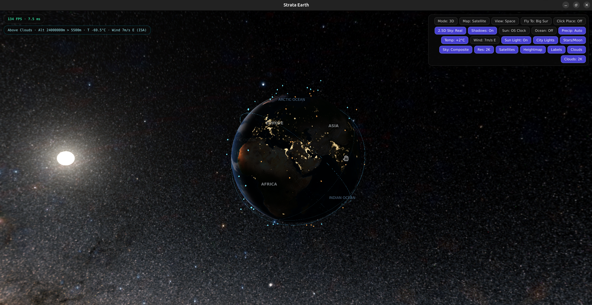
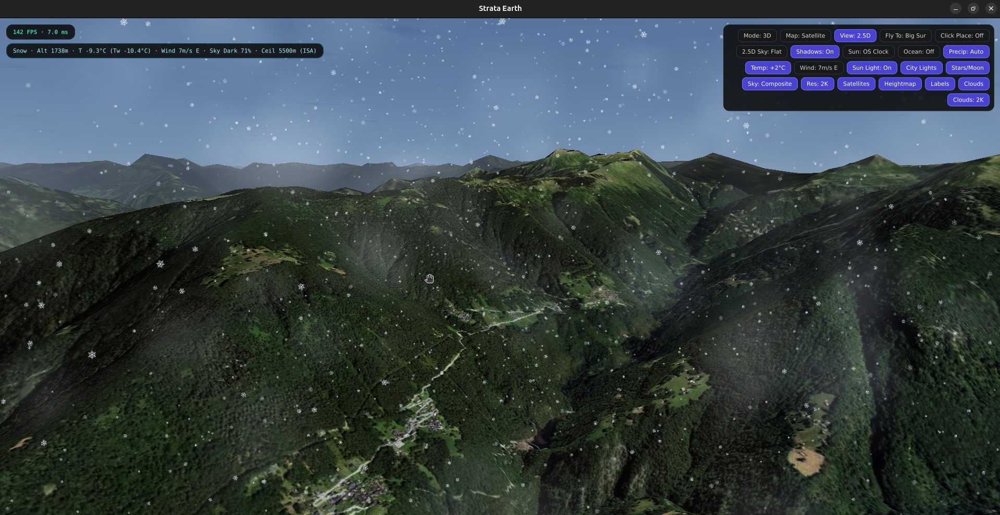
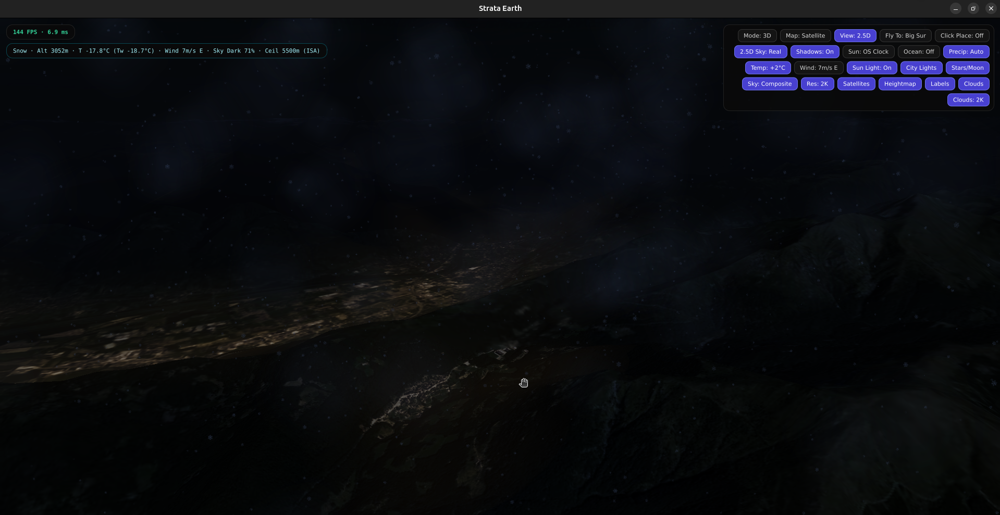
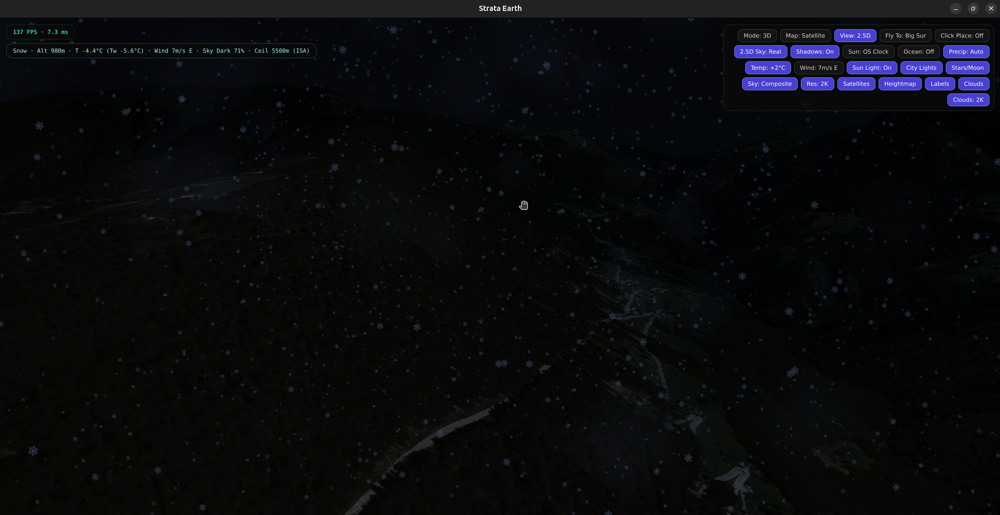

# Earth

High-precision f64 3D geospatial geodesy, quadtree tile LOD streaming & digital twin engine for Strata.


*3D orbital space regime (24,000 km altitude): WGS84 ellipsoidal globe, composite deep-space starfield skybox, live solar lighting and day/night terminator, NASA Black Marble city lights, real-time orbital satellite tracks, projected geographic labels, and automatic above-cloud precipitation cutoff (`Alt 24,000 km > 5,500 m`).*

## Overview

Earth is a sovereign 3D planetary rendering and geospatial geodesy engine designed to render continental, regional, and sub-meter scale digital twins with double-precision (f64) mathematical fidelity.

Traditional 32-bit floating point graphics pipelines suffer catastrophic jitter and precision loss when camera systems transition between orbital views and street-level terrain. Earth solves this with relative-to-eye (RTE) coordinate transformations, WGS84 ellipsoidal geodesy, and Morton-indexed quadtree pyramid LOD management.

## Visual Showcase

### 2.5D Mountain Relief & Daylight Snowfall


*2.5D regional terrain at 1,738 m altitude (`T -9.3°C`, wet-bulb `-10.4°C`, `7 m/s E` wind, `5,500 m` ISA cloud ceiling) combining satellite imagery, DEM heightmap relief, flat daylight sky, and GPU-instanced 6-fold crystalline snowfall.*

### 2.5D Nocturnal Alpine Basin, City Lights & Cloud Deck


*2.5D real-sky nocturnal view at 3,052 m altitude (`T -17.8°C`, wet-bulb `-18.7°C`, `Sky Dark 71%`) showing shadowed mountain ridges, valley-floor NASA Black Marble city lights, nocturnal cloud cover, and GPU-instanced snowfall.*

### 2.5D Low-Altitude Real-Sky Night Valley


*Low-altitude 2.5D valley approach at 980 m (`T -4.4°C`, wet-bulb `-5.6°C`) with physically-driven real-sky atmospheric darkening, terrain shadows, and wind-advected snowfall.*

## Architectural Capabilities

- **High-Precision f64 Geodesy:** Accurate WGS84 planetary ellipsoid mathematics, geodetic latitude/longitude/altitude to Earth-Centered Earth-Fixed (ECEF) and East-North-Up (ENU) coordinate frame transformations.
- **Quadtree Pyramid LOD:** Dynamic tile hierarchy, quadtree neighbor resolution, horizon culling, and camera frustum intersection.
- **Adaptive Terrain Meshing:** Skirt generation to eliminate crack artifacts along tile seams of differing LOD levels.
- **Space & Planetary Environment:** Composite deep-space starfield skybox (Gaia DR3 / BSC5), real-time solar/lunar ephemeris, day/night terminator, NASA Black Marble city lights, global cloud shell, and live orbital satellite propagation.
- **GPU-Instanced 2D Precipitation & Atmosphere:** Physically-driven ISA/moist-adiabatic lapse rate and wet-bulb phase model (rain, sleet, snow) with wind advection, real-sky atmospheric darkening, and automatic above-ceiling cutoff.
- **Golden Camera Regimes:** Deterministic validation across orbital, regional, high-altitude, and ground-level perspective regimes.
- **Structural Frame Descriptors:** Scene-graph inspection, tile coverage analysis, and automated frame regression testing.

## Repository Workspace

- `crates/strata_earth`: Core geodesy engine, terrain generation, slippy map tile pipeline, atmospheric plugins, and camera models.
- `examples/earth_preview`: Main interactive desktop window example (`cargo run -p earth_preview` / `cargo run --bin earth`) featuring mouse pan/orbit/zoom and floating top-right programmatic controls.
- `examples/strata_earth_golden`: Deterministic image and frame capture harness for all Earth camera regimes.

## Verification & Testing

```bash
cargo run --release --bin earth
cargo check --workspace --all-targets
cargo test --workspace
```

## License

Licensed under the MIT License. See [LICENSE](LICENSE) for details.
